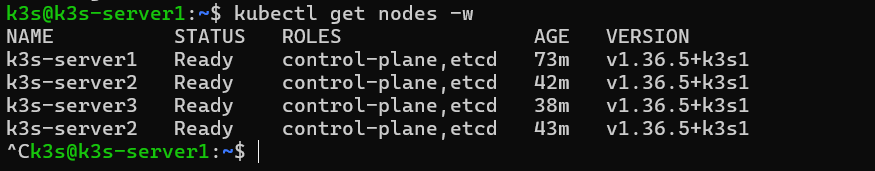
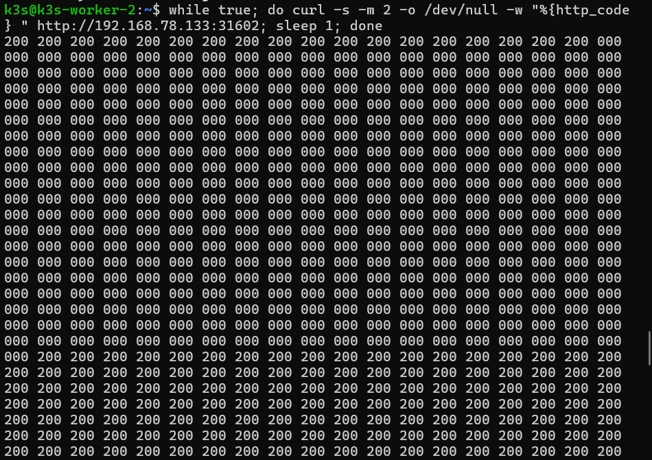
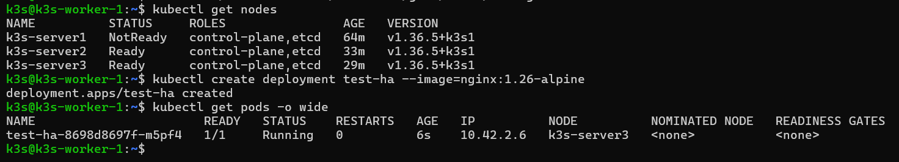
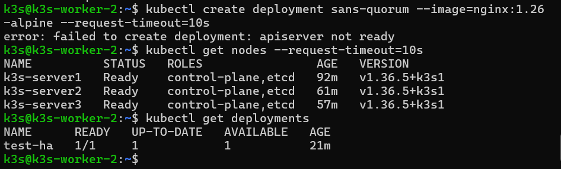
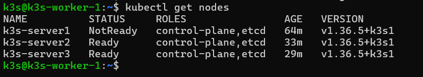

# Lab 8.1 – Cluster k3s en haute disponibilité (3 serveurs, etcd embarqué)

> **Auteur :** Nawres Zarrouki
> **Cours :** Orchestration de conteneurs avec Kubernetes (k3s) – chapitre 8

Construction d'un cluster k3s à **3 serveurs** avec **etcd embarqué**, déploiement d'une application répartie sur les trois nœuds, puis observation de trois situations : perte d'un serveur (le cluster survit), perte du quorum (le control plane est bloqué mais les applications en cours continuent de répondre) et retour à la normale.

## Sommaire

1. [Objectifs et architecture](#1-objectifs-et-architecture)
2. [Étape 1 : préparer les trois VM](#2-étape-1--préparer-les-trois-vm)
3. [Étape 2 : initialiser le premier serveur](#3-étape-2--initialiser-le-premier-serveur)
4. [Étape 3 : joindre les deux autres serveurs](#4-étape-3--joindre-les-deux-autres-serveurs)
5. [Étape 4 : déployer une application répartie](#5-étape-4--déployer-une-application-répartie)
6. [Étape 5 : perdre un serveur](#6-étape-5--perdre-un-serveur)
7. [Étape 6 : perdre le quorum](#7-étape-6--perdre-le-quorum)
8. [Questions de réflexion](#8-questions-de-réflexion)
9. [Dépannage et nettoyage](#9-dépannage-et-nettoyage)
10. [Résumé des captures](#10-résumé-des-captures)

---

## 1. Objectifs et architecture

- Construire un cluster k3s à 3 serveurs avec etcd embarqué.
- Déployer une application répartie sur les trois nœuds.
- Constater qu'un cluster à 3 serveurs **survit à la perte d'un serveur**.
- Constater qu'il **perd son control plane** (mais pas ses applications en cours) **sans quorum**.
- Rétablir le quorum et vérifier le retour à la normale.

```
┌───────────────────┐  ┌───────────────────┐  ┌───────────────────┐
│   k3s-server1     │  │   k3s-server2     │  │   k3s-server3     │
│ control plane+etcd│  │ control plane+etcd│  │ control plane+etcd│
└─────────┬─────────┘  └─────────┬─────────┘  └─────────┬─────────┘
          └────────── etcd répliqué (quorum = 2 sur 3) ──┘
```

Un cluster à un seul serveur est un **point de défaillance unique**. Ici, les trois serveurs répliquent leur état dans un etcd commun et exécutent aussi les applications.

> **Adresse d'accès au control plane :** en production, `kubectl` et les agents joignent les serveurs par une adresse stable (équilibreur, DNS, adresse virtuelle). Ce lab n'en met pas en place : sur chaque serveur, `kubectl` interroge l'API locale, ce qui permet d'administrer le cluster même quand un autre serveur est arrêté.

> **Ce lab reconstruit le cluster :** k3s est désinstallé sur les trois VM, et toutes les ressources précédentes sont perdues. Un snapshot de chaque VM est fait avant de commencer.

---

## 2. Étape 1 : préparer les trois VM

Sur chaque VM (après le snapshot), désinstallation de k3s :

```bash
/usr/local/bin/k3s-uninstall.sh          # sur l'ancien serveur
/usr/local/bin/k3s-agent-uninstall.sh    # sur chaque ancien agent
```

Nom d'hôte unique et adresse IP de chaque VM :

```bash
sudo hostnamectl set-hostname k3s-server1     # k3s-server2 et k3s-server3 sur les deux autres
hostname
ip -4 addr show | grep inet
```

etcd est sensible aux écarts d'horloge : l'heure doit être synchronisée. Le pare-feu `ufw` est désactivé pour le TP (sinon ouvrir en plus `2379-2380/tcp`, communication entre membres etcd) :

```bash
timedatectl | grep -E "synchronized|NTP"
sudo ufw disable
free -h
```

**Point de contrôle :**

- [x] k3s est désinstallé sur les trois VM
- [x] Noms d'hôte uniques : `k3s-server1`, `k3s-server2`, `k3s-server3`
- [x] L'heure est synchronisée sur chaque VM
- [x] Adresses IP notées : `<IP_S1>`, `<IP_S2>`, `<IP_S3>`

<!-- capture à ajouter : captures/01-preparation-vms.png -->

---

## 3. Étape 2 : initialiser le premier serveur

Sur `k3s-server1`, génération d'un **jeton partagé** que les autres serveurs utiliseront. L'installation lit la variable `K3S_TOKEN` : elle se lance dans le même terminal que l'export.

```bash
export K3S_TOKEN=$(openssl rand -hex 16)
echo $K3S_TOKEN
export K3S_VERSION=""      # ou la version communiquée par l'enseignant
curl -sfL https://get.k3s.io | INSTALL_K3S_VERSION=$K3S_VERSION sh -s - server --cluster-init
```

> Le jeton n'est pas écrit dans ce dépôt. S'il est perdu : `sudo cat /var/lib/rancher/k3s/server/token`.

Vérification du serveur, de la version et d'etcd :

```bash
sudo systemctl status k3s --no-pager
sudo k3s --version
sudo k3s kubectl get nodes
sudo ls /var/lib/rancher/k3s/server/db/
```

Configuration de `kubectl` sans `sudo` :

```bash
mkdir -p ~/.kube
sudo cp /etc/rancher/k3s/k3s.yaml ~/.kube/config
sudo chown $USER:$USER ~/.kube/config
chmod 600 ~/.kube/config
alias k=kubectl
k get nodes
```

La version exacte de k3s est notée : les deux autres serveurs doivent utiliser la **même**.

**Point de contrôle :**

- [x] `k3s-server1` est `Ready`
- [x] `/var/lib/rancher/k3s/server/db/` contient un dossier `etcd`
- [x] Le jeton et la version de k3s sont notés



---

## 4. Étape 3 : joindre les deux autres serveurs

Sur `k3s-server2`, puis seulement quand il est `Ready`, sur `k3s-server3` :

```bash
export K3S_TOKEN=<JETON>
export K3S_VERSION=<VERSION_NOTÉE>      # vide si aucune version n'a été imposée
curl -sfL https://get.k3s.io | INSTALL_K3S_VERSION=$K3S_VERSION sh -s - server --server https://<IP_S1>:6443
sudo systemctl status k3s --no-pager
```

Suivi de l'arrivée des nœuds sur le serveur 1, puis vérification des rôles :

```bash
k get nodes -o wide -w
k get nodes
k get nodes -l node-role.kubernetes.io/etcd=true
k get pods -n kube-system -o wide
```

`kubectl` est aussi configuré sur chaque serveur, avec le `k3s.yaml` local.

**Point de contrôle :**

- [x] Trois nœuds `Ready`, rôles `control-plane` et `etcd`
- [x] `k get nodes` fonctionne depuis les trois serveurs
- [x] Les trois serveurs utilisent la même version de k3s

<!-- capture à ajouter : captures/03-trois-noeuds-ready.png -->

---

## 5. Étape 4 : déployer une application répartie

Sur `k3s-server1` :

```bash
k create namespace tp-k8s
k config set-context --current --namespace=tp-k8s
k create deployment web --image=nginx:1.26-alpine --replicas=3
k expose deployment web --port=80 --type=NodePort
k get pods -o wide
k get service web
```

Le `NodePort` est noté (colonne `PORT(S)`, de la forme `80:3xxxx/TCP`). Dans un second terminal sur `k3s-server3`, une boucle de requêtes reste ouverte pendant tout le lab. Un code `200` s'affiche chaque seconde ; un `000` signale une requête échouée.

```bash
while true; do curl -s -m 2 -o /dev/null -w "%{http_code} " http://<IP_S3>:<NODEPORT>; sleep 1; done
```

**Point de contrôle :**

- [x] Trois Pods `web`, répartis sur plusieurs nœuds
- [x] La boucle affiche des `200` en continu



---

## 6. Étape 5 : perdre un serveur

Arrêt brutal de `k3s-server1`, comme lors d'une panne :

```bash
sudo poweroff
```

Sur `k3s-server2`, observation de la réponse de l'API locale :

```bash
k get nodes
k get nodes --watch
```

Au bout d'une quarantaine de secondes, `k3s-server1` passe à `NotReady`. Dans la boucle de `k3s-server3`, quelques `000` peuvent apparaître tant que le Service envoie des requêtes à un Pod du nœud arrêté. Le cluster reste utilisable **en écriture** :

```bash
k create deployment test-ha --image=nginx:1.26-alpine
k get pods -o wide
```

Les Pods de `k3s-server1` sont replanifiés ailleurs après environ 5 minutes (`k get pods -o wide -w`). La VM est ensuite rallumée et rejoint le cluster d'elle-même :

```bash
k get nodes -w
```

**Point de contrôle :**

- [x] `k3s-server1` est `NotReady` sans bloquer `kubectl` sur les deux autres serveurs
- [x] Le Deployment `test-ha` a été créé pendant la panne
- [x] La boucle a eu au plus quelques échecs, puis est revenue à `200`
- [x] Après redémarrage, `k3s-server1` est de nouveau `Ready`

### server1 en NotReady



### Création pendant la panne

<!-- capture à ajouter : captures/06-test-ha-cree.png -->

### Retour du serveur



---

## 7. Étape 6 : perdre le quorum

Arrêt de **deux** serveurs sur trois, `k3s-server1` et `k3s-server2` :

```bash
sudo poweroff        # sur k3s-server1, puis sur k3s-server2
```

Sur `k3s-server3`, le dernier serveur, tentative d'utiliser le cluster :

```bash
k get nodes --request-timeout=10s
k create deployment sans-quorum --image=nginx:1.26-alpine --request-timeout=10s
```

Les commandes échouent ou expirent : il n'y a plus de majorité (1 serveur sur 3). Pourtant, la boucle de requêtes peut continuer à afficher `200` si elle atteint un Pod encore en exécution sur `k3s-server3` : les applications en cours tournent, mais le cluster ne peut **plus rien changer**.

Rétablissement du quorum en rallumant d'abord `k3s-server2`, puis `k3s-server1` :

```bash
k get nodes --request-timeout=10s
k get nodes -w
k get deployment
k get pods -o wide
```

L'objet `sans-quorum` n'existe pas : la commande de création avait échoué.

**Point de contrôle :**

- [x] Sans quorum, `k get nodes` et `k create` échouent ou expirent
- [x] Les applications en cours ont continué à répondre quand le Pod était sur `k3s-server3`
- [x] Après le retour d'un deuxième serveur, `kubectl` fonctionne de nouveau
- [x] Les Deployments créés avant les pannes (`web`, `test-ha`) sont toujours présents

### Quorum perdu

<!-- capture à ajouter : captures/08-quorum-perdu.png -->

### Quorum rétabli

<!-- capture à ajouter : captures/09-quorum-retabli.png -->

---

## 8. Questions de réflexion

**1. Pourquoi le cluster est-il resté utilisable quand un seul serveur était arrêté ?**
etcd travaille à la majorité : avec 3 membres, le quorum est de 2. Un serveur arrêté laisse 2 membres, donc une majorité : les lectures et écritures de l'API continuent, et `kubectl` répond sur les deux serveurs restants.

**2. Pourquoi `kubectl` a-t-il cessé de fonctionner quand deux serveurs sont tombés ?**
Il ne reste qu'un membre sur trois, soit moins que la majorité. etcd refuse alors de servir des requêtes pour ne pas risquer de diviser l'état du cluster (*split-brain*) : l'API ne peut plus lire ni écrire, et les commandes expirent.

**3. Pourquoi la boucle de requêtes a-t-elle pu continuer à répondre pendant la perte du quorum ?**
Les conteneurs sont exécutés par le kubelet et le runtime de chaque nœud, et les règles réseau du Service sont déjà programmées. Le **plan de données** (les Pods en cours) ne dépend pas du **plan de contrôle** : tant qu'un Pod tourne sur `k3s-server3`, il répond. Seul le cluster ne peut plus se modifier.

**4. Pourquoi quelques requêtes ont-elles échoué quand un serveur est tombé, alors que le cluster est en HA ?**
La haute disponibilité du control plane ne protège pas les Pods du nœud arrêté. Tant que le nœud n'est pas déclaré `NotReady` (environ 40 secondes), le Service garde ses Pods parmi les destinations et envoie des requêtes à un Pod injoignable (`000`). Ces Pods ne sont replanifiés qu'après environ 5 minutes.

**5. Quelles limites de cette installation à 3 serveurs resteraient à lever pour une production ?**

- une **adresse stable** pour l'API (équilibreur, DNS ou adresse virtuelle) : ici `kubectl` pointe sur un serveur précis ;
- des **sauvegardes d'etcd** (snapshots) à l'extérieur du cluster ;
- les trois VM sont sur **le même hôte physique** : une panne de l'hôte les emporte toutes ;
- un **pare-feu** correctement configuré (`ufw` est désactivé pour le TP) ;
- des applications avec **réplicas répartis** (anti-affinité) et un stockage répliqué (`local-path` est local à un nœud) ;
- **supervision**, procédure de **mise à jour** et gestion des certificats et du jeton.

---

## 9. Dépannage et nettoyage

| Symptôme | Pistes |
|---|---|
| Le serveur 2 ou 3 ne rejoint pas | `sudo journalctl -u k3s -n 50` ; vérifier le jeton, l'URL `https://<IP_S1>:6443`, le pare-feu (6443, 2379-2380, 8472, 10250) |
| `token incorrect` ou `bootstrap data already found` | Jeton différent du premier serveur, ou VM mal nettoyée : désinstaller k3s et recommencer |
| Deux nœuds portent le même nom | Changer le nom d'hôte, puis désinstaller et réinstaller k3s |
| Un serveur reste `NotReady` | Attendre 1 à 2 minutes ; `k describe node <nom>` ; vérifier l'heure |
| `etcdserver: request timed out` | Quorum perdu ou machines surchargées : compter les serveurs actifs, `free -h` |
| `connection refused` sur un serveur redémarré | k3s met une minute à démarrer : `sudo systemctl status k3s` |

Nettoyage (le cluster n'est **pas** désinstallé, le Lab 8.2 s'appuie dessus) :

```bash
k delete namespace tp-k8s
k config set-context --current --namespace=default
```

La boucle de requêtes est arrêtée avec `Ctrl+C`, puis un snapshot de chaque VM permet de revenir à ce cluster HA propre.

---

## 10. Résumé des captures

| Capture | Contenu |
|---|---|
| `01-preparation-vms.png` | Noms d'hôte, heure synchronisée, k3s désinstallé |
| `02-server1-ready.png` | `k3s-server1` `Ready` et dossier `etcd` |
| `03-trois-noeuds-ready.png` | Trois nœuds `Ready` (control-plane, etcd) |
| `04-application-repartie.png` | Pods `web` répartis et boucle de `200` |
| `05-server1-notready.png` | `k3s-server1` en `NotReady` |
| `06-test-ha-cree.png` | Deployment `test-ha` créé pendant la panne |
| `07-server1-rejoint.png` | `k3s-server1` de nouveau `Ready` |
| `08-quorum-perdu.png` | `kubectl` qui expire sans quorum |
| `09-quorum-retabli.png` | Trois nœuds `Ready`, Deployments conservés |

---

## Captures supplémentaires

**kubectl get nodes**


**Lab8.1 Capture 05 Panne Serveur1 NotReady**



